# Microservices Failure Lab

[Leia em português](README.pt-BR.md)

A reproducible lab for the paper **"Análise de Cenários de Falha em Microsserviços: Uma Abordagem
Baseada em Observabilidade"** (Failure scenario analysis in microservices: an observability-based
approach), IFCE, 2025. It shows how metrics, logs and distributed traces detect and explain four
common failures in microservices.

The paper is [`docs/paper.pdf`](docs/paper.pdf) and the slides are
[`docs/slides.pdf`](docs/slides.pdf); [`docs/README.md`](docs/README.md) explains how they relate to
the lab. Every claim they make about the tools is checked
against this lab in the [credibility checklist](docs/credibility-checklist.md).

## Architecture

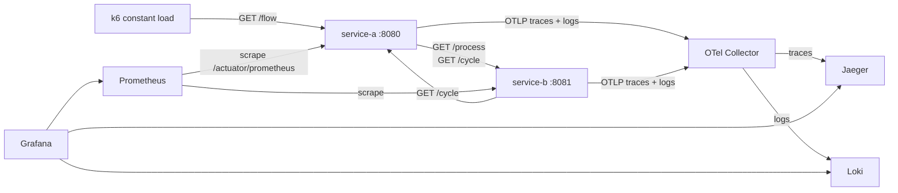

- **service-a** and **service-b**: Spring Boot 3.5, Java 17.
- **Metrics**: Micrometer → Prometheus.
- **Traces and logs**: OpenTelemetry (OTLP) → Collector → Jaeger and Loki.
- **Dashboard**: Grafana, with the `Failure Lab` dashboard provisioned.
- **Background load**: k6 sends 5 requests/s to `GET /flow`, so every scenario shows a before,
  during and after.

Design decisions are in [`docs/architecture.md`](docs/architecture.md) and
[`docs/adr/`](docs/adr/).

## Requirements

- Docker with Compose v2.
- A Linux kernel for the `tc` scenario (a Linux host, or Docker Desktop's VM).
- About 3 GB of free RAM.

## Quick start

```bash
./lab.sh up
```

| Tool | URL |
|---|---|
| Grafana (dashboard "Failure Lab", no login) | http://localhost:3000 |
| Jaeger | http://localhost:16686 |
| Prometheus | http://localhost:9090 |
| service-a | http://localhost:8080/flow |

`./lab.sh status` shows which scenarios are active. `./lab.sh down` stops everything.

## Scenarios

### 1. High latency

- **What it simulates**: service-b becomes slow (a 2 s delay before answering), as a slow
  dependency would.
- **Run**: `./lab.sh latency` (or `./lab.sh latency 2500` for another delay in ms). Keep it below
  3000: service-a gives up on service-b after 3 s, so a longer delay turns into 504 timeouts
  instead of latency.
- **Grafana**: "p95 server latency" and "p95 client latency A -> B" jump to about 2 s.
- **Prometheus**: `http_server_requests_seconds` and `http_client_requests_seconds` histograms.
- **Jaeger**: in a `GET /flow` trace, almost all the time sits in the service-b
  `http get /process` span.
- **Loki**: the WARN `Scenario latency activated` from service-b marks the start.
- **Paper**: sections 3 (item 1) and 4.1; slides 7 and 8.

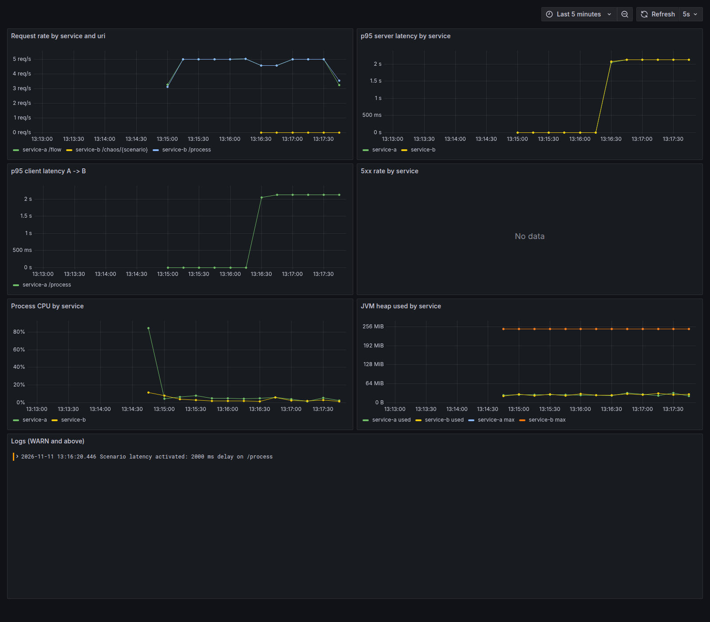

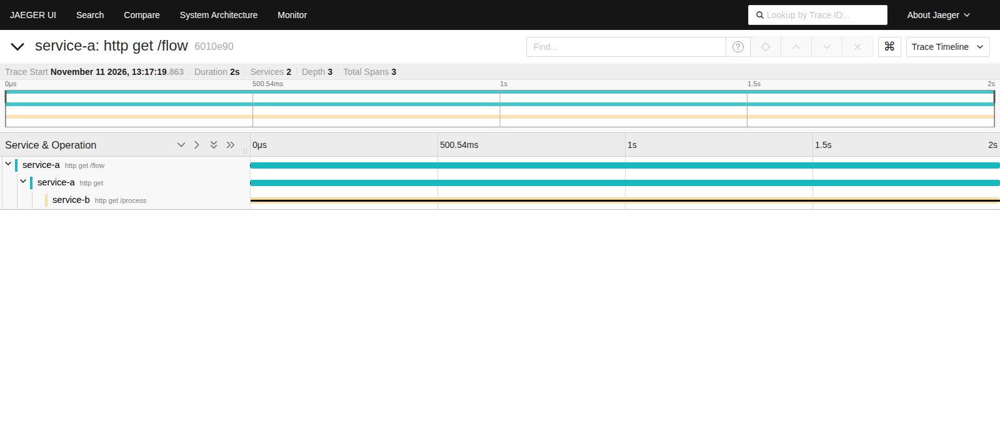

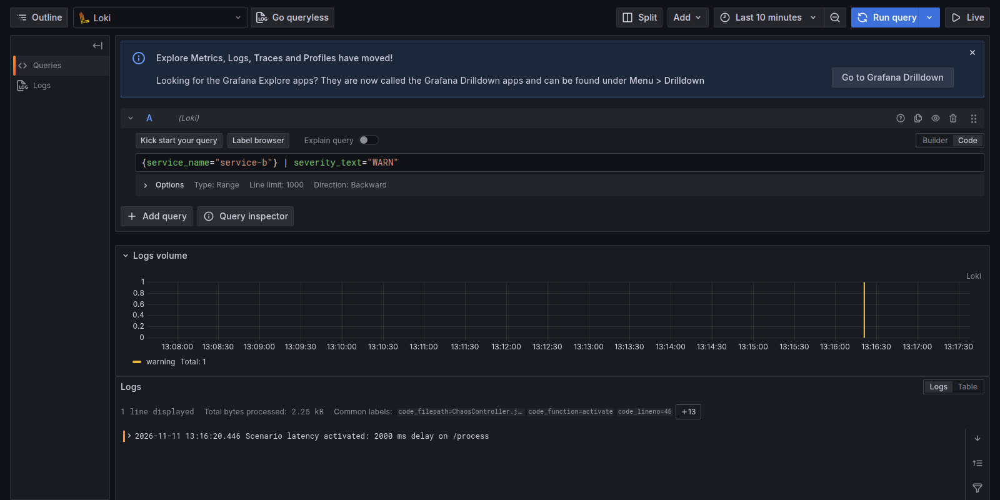

### 2. Cyclic dependency

- **What it simulates**: A calls B, B calls A back, and so on, until a limit of 10 calls stops
  the cycle.
- **Run**: `./lab.sh cycle`.
- **Grafana**: "Request rate" shows `/cycle` at five times the `/flow` rate.
- **Prometheus**: `http_server_requests_seconds_count{uri="/cycle"}`.
- **Jaeger**: one trace per request with spans alternating between service-a and service-b,
  depth 1 to 10.
- **Loki**: `Cycle hop depth=N` per hop and the WARN `Cycle limit reached at depth 10`, with the
  same `trace_id` as the trace.
- **Paper**: sections 3 (item 2) and 4.2; slides 7 and 9.

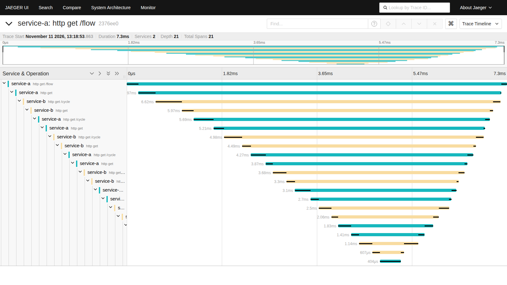

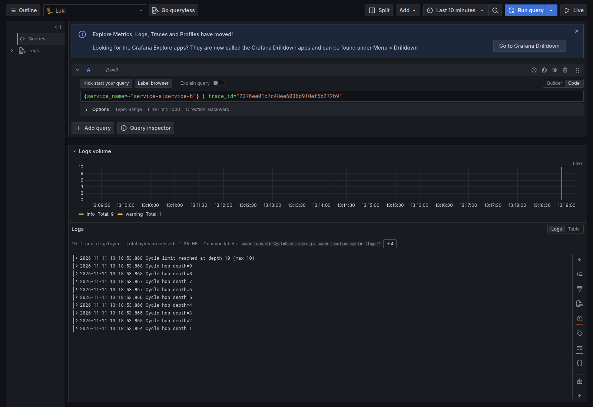

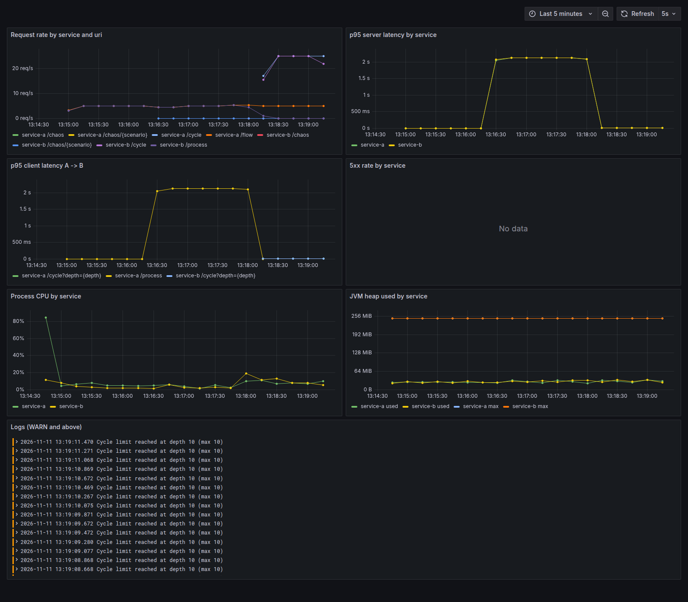

### 3. Resource exhaustion

- **What it simulates**: service-a burns CPU on 2 threads and allocates 2 MB of heap every 500 ms
  until the JVM (256 MB heap) throws a real `OutOfMemoryError`. The scenario catches it, logs it,
  releases the memory and the service keeps answering.
- **Run**: `./lab.sh resources`. The OOM comes after about one minute.
- **Grafana**: "Process CPU" of service-a goes to 100 % and "JVM heap used" climbs to the max,
  then drops.
- **Prometheus**: `process_cpu_usage`, `jvm_memory_used_bytes{area="heap"}`.
- **Loki**: ERROR `OutOfMemoryError during resource-exhaustion scenario after N MB allocated`,
  with the exception `java.lang.OutOfMemoryError: Java heap space`.
- **Paper**: sections 3 (item 3) and 4.3; slides 7 and 10.

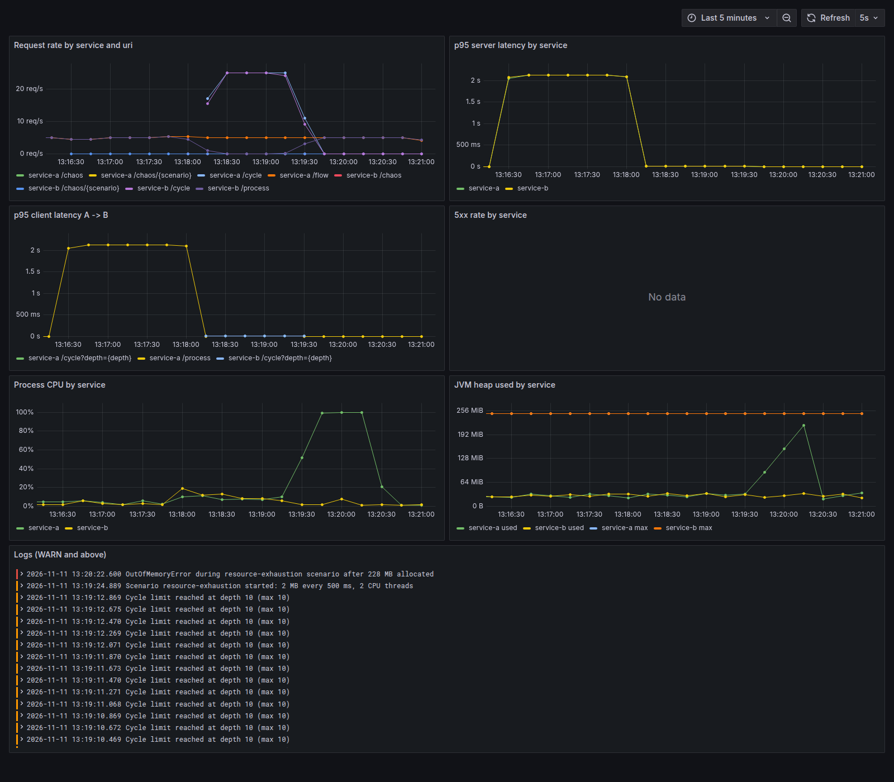

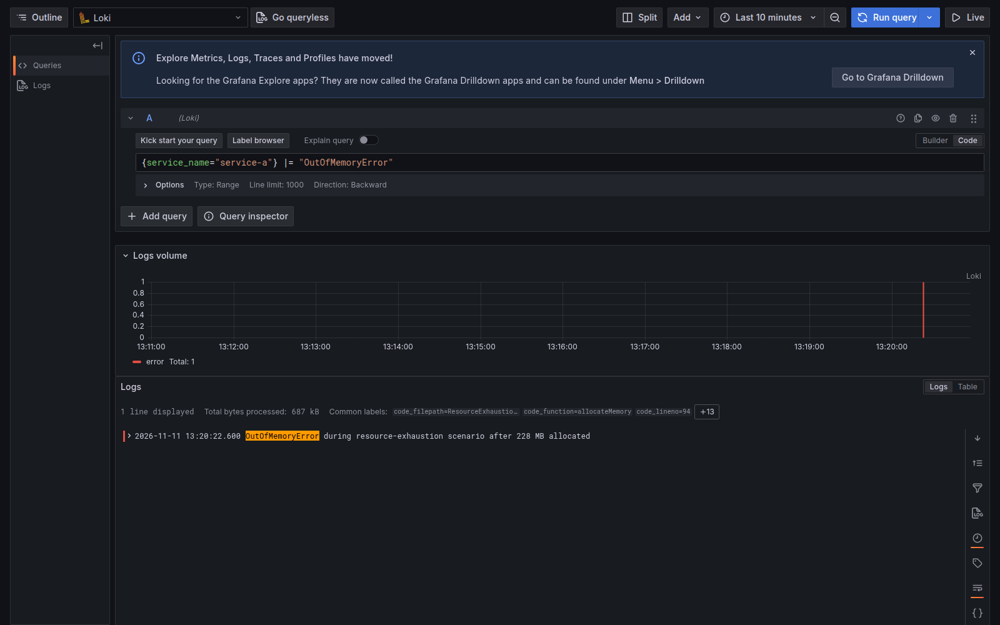

### 4. Network communication failures

- **What it simulates**, in two ways:
  - `tc netem` inside service-b adds 800 ms ± 200 ms of delay and 20 % packet loss;
  - service-b is stopped.
- **Run**: `./lab.sh network-tc` or `./lab.sh network-down`.
- **Grafana**: with `tc`, latency rises and part of the calls fail with 504 (about 7 %); with service-b down, every call fails with 502.
- **Prometheus**: `http_server_requests_seconds_count{status=~"5.."}`.
- **Jaeger**: the `GET /flow` span and its call to service-b are marked as errors. With `tc`,
  the service-b span shows it answered in milliseconds, so the time was lost in the network. With
  service-b down, there is no service-b span at all.
- **Loki**: ERROR `Call to service-b /process failed`, with the exception (timeout or host not
  reachable) and the `trace_id`.
- **Paper**: sections 3 (item 4) and 4.4; slides 7 and 11.

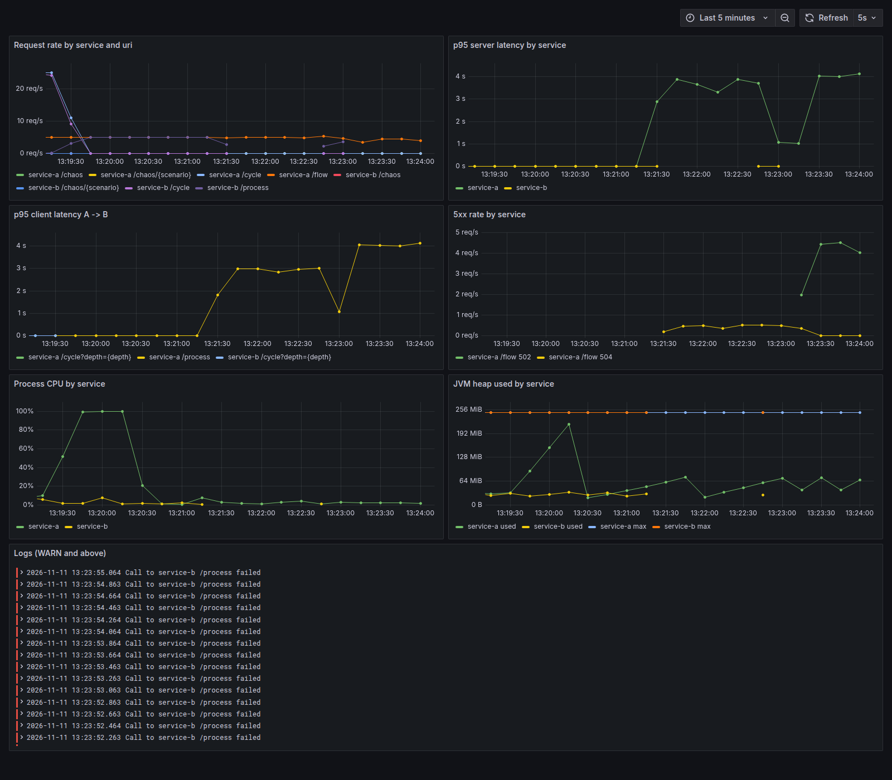

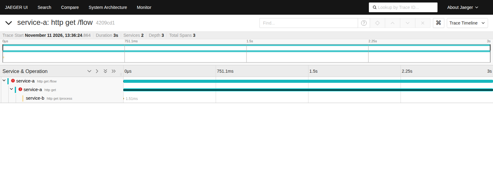

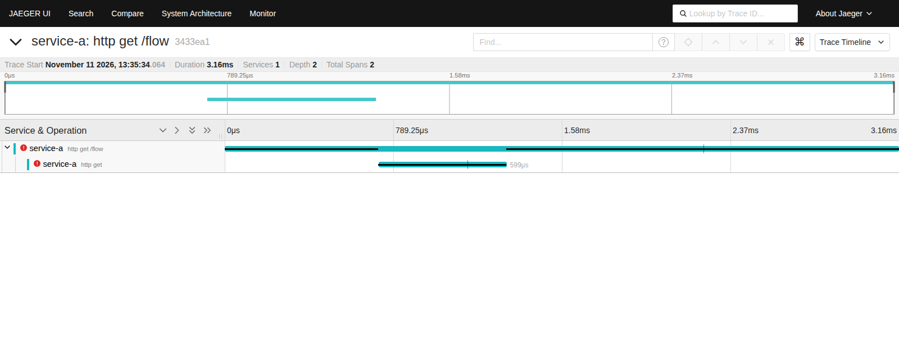

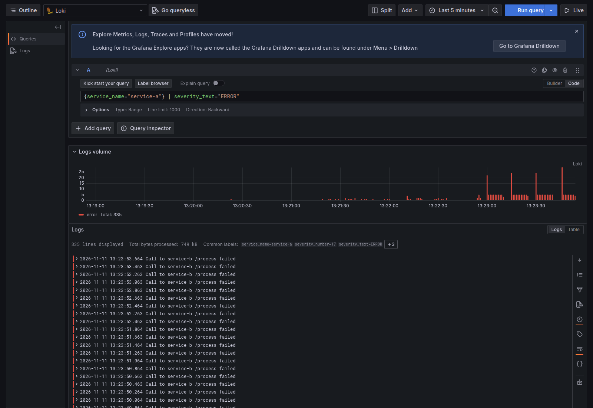

## Reset

```bash
./lab.sh reset
```

Restarts service-b if it was stopped, removes the `tc` rule and turns every scenario off, without
recreating the lab.

## Credibility

- [Credibility checklist](docs/credibility-checklist.md): every claim of the paper and slides
  with its status and evidence.
- [Divergences](docs/divergences.md): what the lab did not confirm in the approved text, and how
  the revised paper now says it.

## Security note

This is a local lab. The `/chaos` endpoints have no authentication, Grafana opens without login
as admin, and service-b runs with `NET_ADMIN`. Do not expose it to a network.

## Credits

Lucas Alves Meneses, advised by Cidcley Teixeira de Souza. Departamento de Telemática (DTEL),
Instituto Federal do Ceará (IFCE).
