# Microservices Failure Lab

[Read in English](README.md)

Laboratório reproduzível do TCC **"Análise de Cenários de Falha em Microsserviços: Uma Abordagem
Baseada em Observabilidade"**, IFCE, 2025. Mostra como métricas, logs e rastreamento distribuído
detectam e explicam quatro falhas comuns em microsserviços.

O texto está em [`docs/paper.pdf`](docs/paper.pdf) e a apresentação em
[`docs/slides.pdf`](docs/slides.pdf); o [`docs/README.md`](docs/README.md) explica como eles se
ligam ao laboratório. Cada afirmação que eles fazem sobre as
ferramentas é conferida neste laboratório no [checklist de credibilidade](docs/credibility-checklist.md).

## Arquitetura

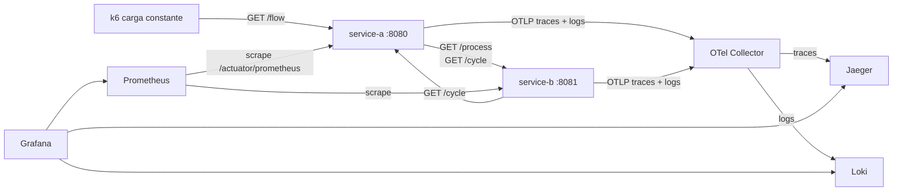

- **service-a** e **service-b**: Spring Boot 3.5, Java 17.
- **Métricas**: Micrometer → Prometheus.
- **Traces e logs**: OpenTelemetry (OTLP) → Collector → Jaeger e Loki.
- **Dashboard**: Grafana, com o dashboard `Failure Lab` já provisionado.
- **Carga de fundo**: o k6 envia 5 requisições/s para `GET /flow`, então cada cenário mostra o
  antes, o durante e o depois.

As decisões de projeto estão em [`docs/architecture.md`](docs/architecture.md) e
[`docs/adr/`](docs/adr/).

## Requisitos

- Docker com Compose v2.
- Kernel Linux para o cenário com `tc` (host Linux ou a VM do Docker Desktop).
- Cerca de 3 GB de RAM livre.

## Início rápido

```bash
./lab.sh up
```

| Ferramenta | URL |
|---|---|
| Grafana (dashboard "Failure Lab", sem login) | http://localhost:3000 |
| Jaeger | http://localhost:16686 |
| Prometheus | http://localhost:9090 |
| service-a | http://localhost:8080/flow |

`./lab.sh status` mostra quais cenários estão ativos. `./lab.sh down` desliga tudo.

## Cenários

### 1. Latência elevada

- **O que simula**: o service-b fica lento (atraso de 2 s antes de responder), como uma
  dependência lenta.
- **Como disparar**: `./lab.sh latency` (ou `./lab.sh latency 2500` para outro atraso em ms).
  Use menos de 3000: o service-a desiste do service-b após 3 s, então um atraso maior vira
  timeout 504 em vez de latência.
- **Grafana**: "p95 server latency" e "p95 client latency A -> B" sobem para cerca de 2 s.
- **Prometheus**: histogramas `http_server_requests_seconds` e `http_client_requests_seconds`.
- **Jaeger**: num trace de `GET /flow`, quase todo o tempo fica no span `http get /process` do
  service-b.
- **Loki**: o WARN `Scenario latency activated` do service-b marca o início.
- **TCC**: seções 3 (item 1) e 4.1; slides 7 e 8.

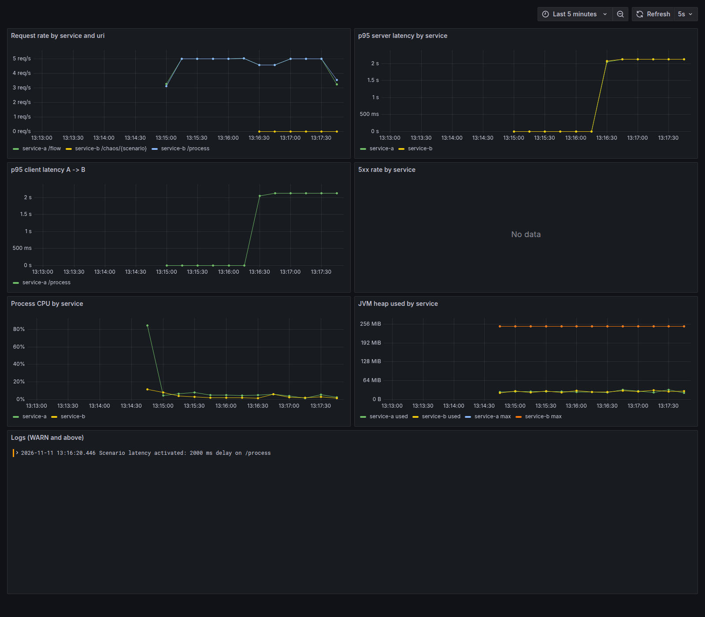

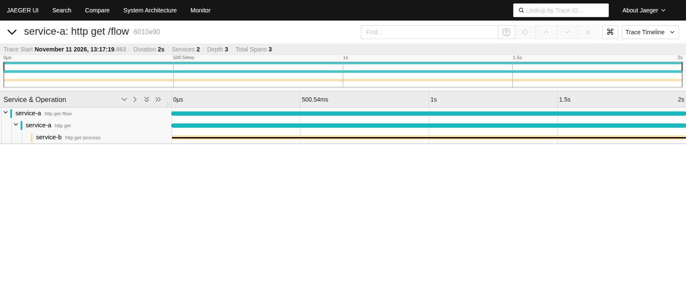

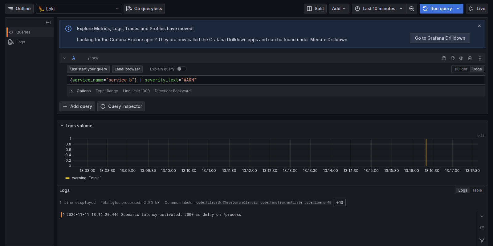

### 2. Dependência cíclica

- **O que simula**: A chama B, B chama A de volta, e assim por diante, até um limite de 10
  chamadas encerrar o ciclo.
- **Como disparar**: `./lab.sh cycle`.
- **Grafana**: "Request rate" mostra `/cycle` com cinco vezes a taxa de `/flow`.
- **Prometheus**: `http_server_requests_seconds_count{uri="/cycle"}`.
- **Jaeger**: um trace por requisição, com spans alternando entre service-a e service-b, da
  profundidade 1 à 10.
- **Loki**: `Cycle hop depth=N` a cada salto e o WARN `Cycle limit reached at depth 10`, com o
  mesmo `trace_id` do trace.
- **TCC**: seções 3 (item 2) e 4.2; slides 7 e 9.

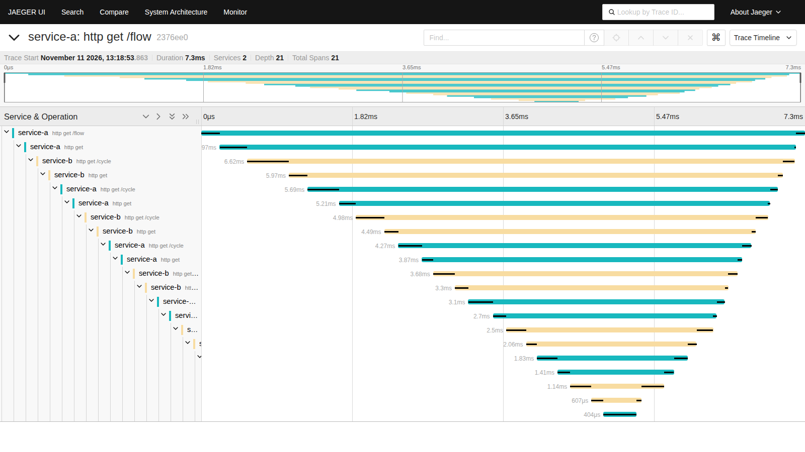

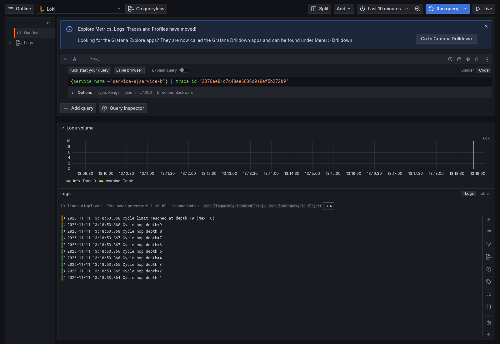

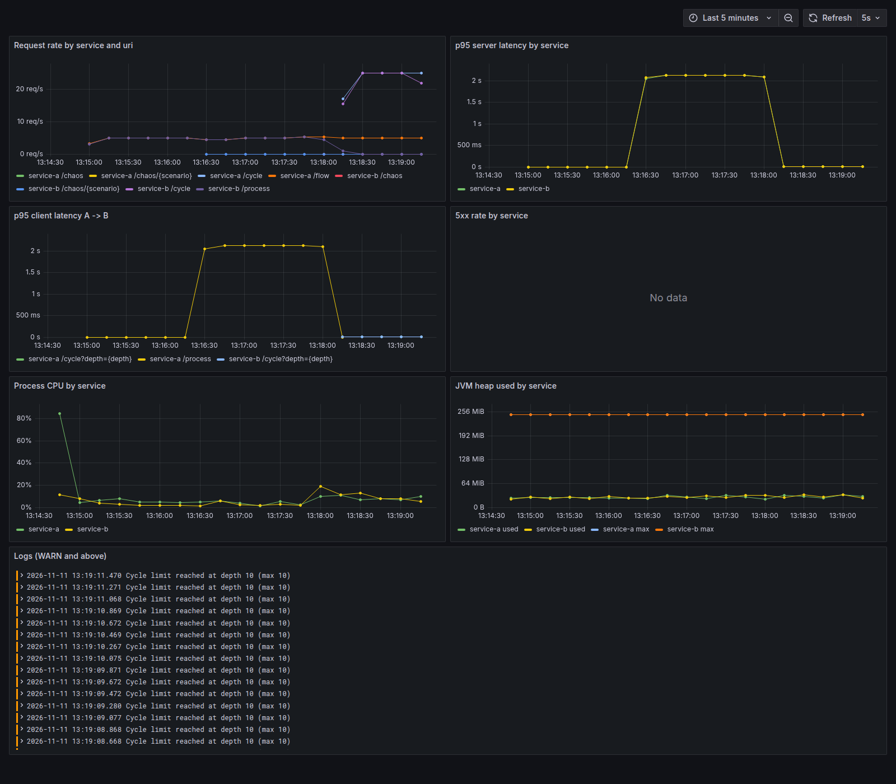

### 3. Esgotamento de recursos

- **O que simula**: o service-a consome CPU em 2 threads e aloca 2 MB de heap a cada 500 ms, até
  a JVM (heap de 256 MB) lançar um `OutOfMemoryError` real. O cenário captura o erro, registra no
  log, libera a memória e o serviço continua respondendo.
- **Como disparar**: `./lab.sh resources`. O OOM chega em cerca de um minuto.
- **Grafana**: "Process CPU" do service-a vai a 100 % e "JVM heap used" sobe até o máximo e
  depois cai.
- **Prometheus**: `process_cpu_usage`, `jvm_memory_used_bytes{area="heap"}`.
- **Loki**: ERROR `OutOfMemoryError during resource-exhaustion scenario after N MB allocated`,
  com a exceção `java.lang.OutOfMemoryError: Java heap space`.
- **TCC**: seções 3 (item 3) e 4.3; slides 7 e 10.

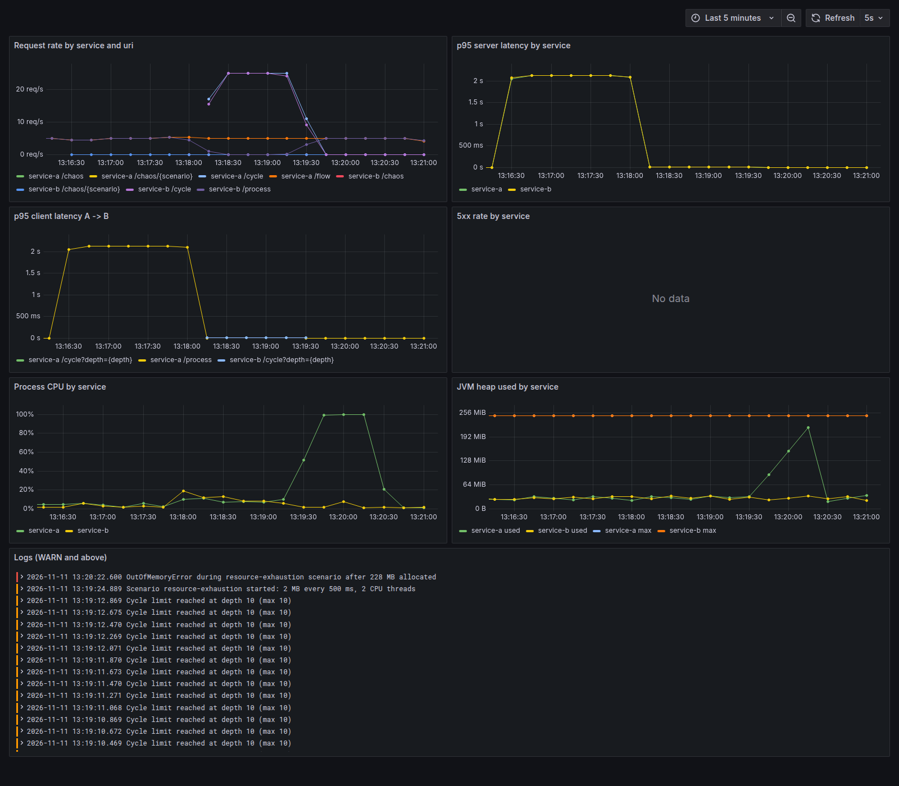

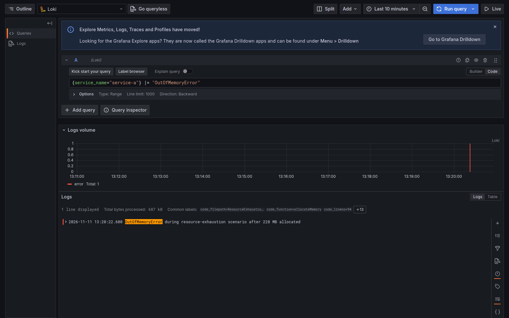

### 4. Falhas de comunicação em rede

- **O que simula**, de duas formas:
  - `tc netem` dentro do service-b, com atraso de 800 ms ± 200 ms e 20 % de perda de pacotes;
  - o service-b é parado.
- **Como disparar**: `./lab.sh network-tc` ou `./lab.sh network-down`.
- **Grafana**: com `tc`, a latência sobe e parte das chamadas falha com 504 (cerca de 7 %); com o service-b
  parado, todas as chamadas falham com 502.
- **Prometheus**: `http_server_requests_seconds_count{status=~"5.."}`.
- **Jaeger**: o span de `GET /flow` e a chamada ao service-b ficam marcados como erro. Com `tc`, o
  span do service-b mostra que ele respondeu em milissegundos, então o tempo se perdeu na rede.
  Com o service-b parado, não existe nenhum span do service-b.
- **Loki**: ERROR `Call to service-b /process failed`, com a exceção (timeout ou host
  inalcançável) e o `trace_id`.
- **TCC**: seções 3 (item 4) e 4.4; slides 7 e 11.

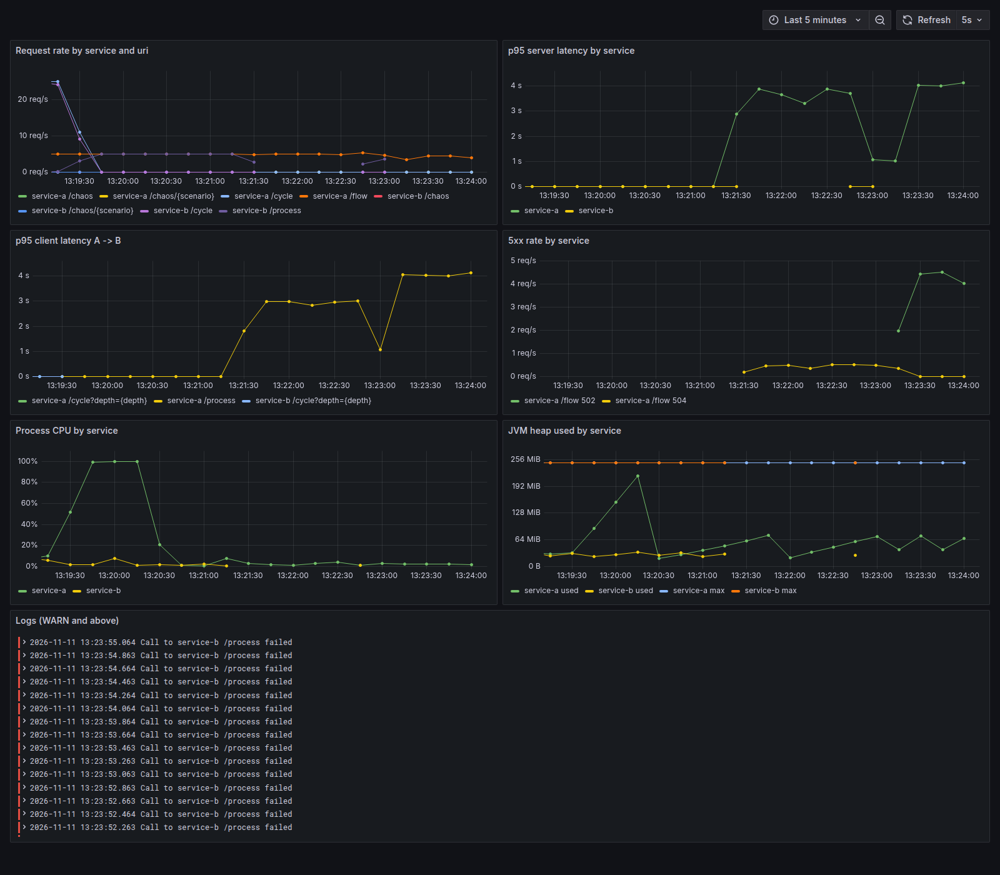

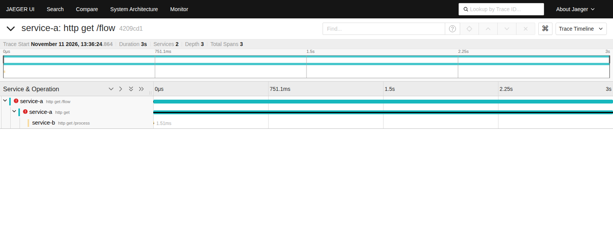

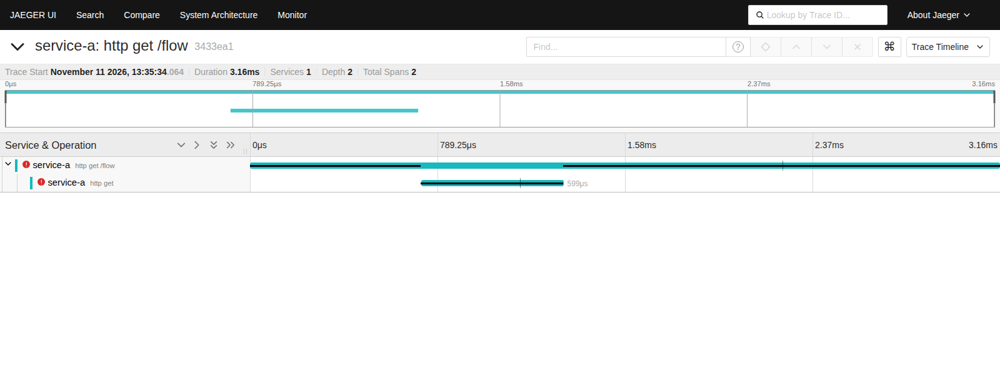

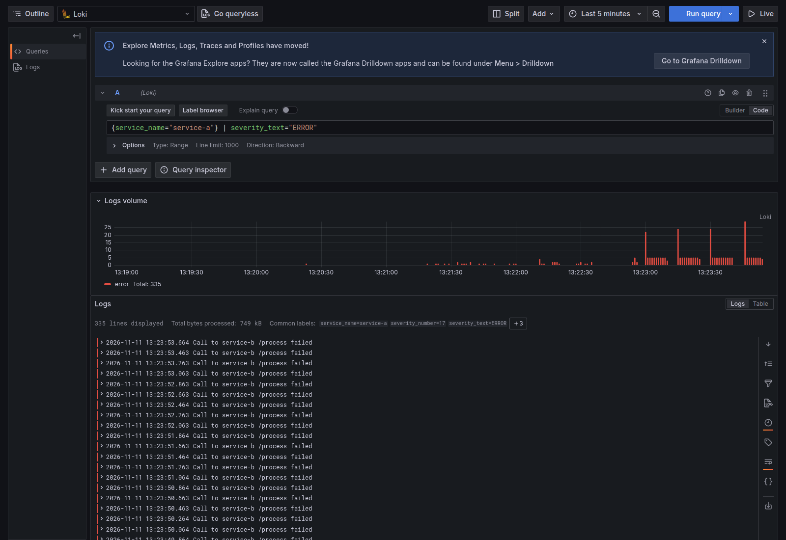

## Reset

```bash
./lab.sh reset
```

Religa o service-b se ele estiver parado, remove a regra do `tc` e desliga todos os cenários,
sem recriar o laboratório.

## Credibilidade

- [Checklist de credibilidade](docs/credibility-checklist.md): cada afirmação do TCC e dos
  slides, com status e evidência.
- [Divergências](docs/divergences.md): o que o laboratório não confirmou no texto aprovado e como
  o texto revisado passou a dizer.

## Aviso de segurança

Este é um laboratório local. Os endpoints `/chaos` não têm autenticação, o Grafana abre sem login
como admin e o service-b roda com `NET_ADMIN`. Não exponha o laboratório numa rede.

## Créditos

Lucas Alves Meneses, orientado por Cidcley Teixeira de Souza. Departamento de Telemática (DTEL),
Instituto Federal do Ceará (IFCE).
