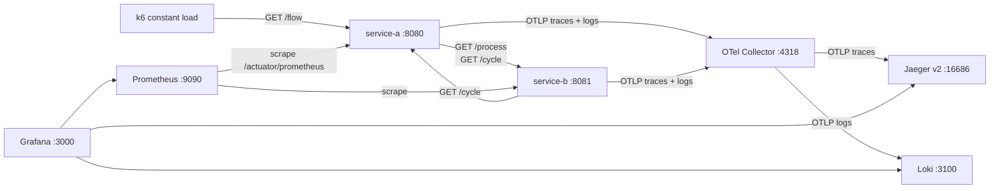

# Architecture — Microservices Failure Lab

Lab that reproduces the four failure scenarios of the paper "Análise de Cenários de Falha em
Microsserviços: Uma Abordagem Baseada em Observabilidade" (IFCE, 2025) and shows each one in
Prometheus, Grafana, Loki and Jaeger.

## Forces

- **Purpose**: credibility. Every claim in sections 3 and 4 of the paper and the defense slides must be
  reproducible, with real telemetry only.
- **Runs on**: one laptop with Docker only. Reference machine: 8 CPUs, 15 GB RAM,
  Docker 28 / Compose v2. Whole stack must stay under ~3 GB RAM.
- **Reproducibility**: a stranger clones and runs it with one command; pinned versions.
- **Team**: solo developer. Boring tools, little code, no speculative features.
- **Not a benchmark**: no performance targets. Load is low and constant.

## Containers

## Modules

Both services are Spring Boot 3.5 / Java 17, one Maven module each, package
`com.failurelab.service_a` / `com.failurelab.service_b`, organized by feature:

| Package | service-a | service-b |
|---|---|---|
| `flow` | `GET /flow`: calls B `/process` | `GET /process`: applies `latency` if active |
| `cycle` | `GET /cycle`: calls B until max depth | `GET /cycle`: calls A until max depth |
| `chaos` | toggles `cycle`, `resource-exhaustion`; exhaustion job | toggle `latency` |
| `client` | `ServiceBClient` (RestClient with timeouts) | `ServiceAClient` |
| `error` | `@RestControllerAdvice` mapping errors to the error format | same |

No database. Scenario state is in memory (lost on restart, by design).

## Contract conventions

- JSON bodies. Error format: `{"error": "<CODE>", "message": "<text>"}`.
- Downstream failures from service-a: connection refused or 5xx from B → `502 DOWNSTREAM_ERROR`;
  read timeout → `504 DOWNSTREAM_TIMEOUT`.
- Lab controls under `/chaos` (ADR 0006), never under `/actuator`.
- Client timeouts A ↔ B: connect 1 s, read 3 s.

## Observability

- **Metrics**: Micrometer → `/actuator/prometheus`, scraped every 5 s. Histograms on
  `http.server.requests` and `http.client.requests`. Tag `application`.
- **Traces**: Micrometer Tracing (OTel bridge) → OTLP/HTTP → Collector → Jaeger. Sampling 100 %.
  Propagation W3C `tracecontext`. Outbound calls use the Spring-managed `RestClient.Builder` so
  context propagates.
- **Logs**: Logback → OpenTelemetry Logback appender → OTLP/HTTP → Collector → Loki. Console
  output kept with trace id.
- **Grafana**: datasources and the `Failure Lab` dashboard provisioned from files.

## Deployment

`docker compose --profile load up -d --build`, wrapped by `./lab.sh up`. Multi-stage images,
JRE runtime, pinned third-party images (ADR 0005).

## Tests

- Unit: JUnit 5 + Mockito + Spring `@WebMvcTest` per service (`qa`).
- End to end: the lab itself; each acceptance criterion checked in the tools and recorded with a
  screenshot in `docs/credibility-checklist.md`.

## ADRs

- [0001 — OTel Collector telemetry pipeline](adr/0001-otel-collector-telemetry-pipeline.md)
- [0002 — Real OOM caught in-process](adr/0002-real-oom-caught-in-process.md)
- [0003 — k6 constant background load](adr/0003-k6-constant-background-load.md)
- [0004 — tc netem inside service-b](adr/0004-tc-netem-inside-service-b.md)
- [0005 — Pinned images and Jaeger v2](adr/0005-pinned-images-and-jaeger-v2.md)
- [0006 — Chaos control API](adr/0006-chaos-control-api.md)
